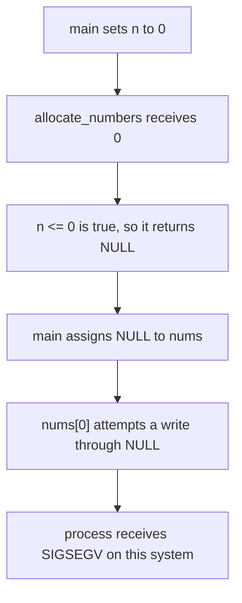

# Crash Report: `crash_example.c`

## Crash description

The program was compiled without changing the supplied source:

```bash
make crash_example
```

The build used the supplied flags:

```text
-Wall -Wextra -Werror -pedantic -std=gnu89 -g
```

Running `./crash_example` produced:

```text
crash_example: deterministic NULL dereference (segmentation fault)
  requesting n=0
```

The process then terminated with exit status `139`. On this Linux system,
`139` represents `128 + 11`, where signal 11 is `SIGSEGV`. The later
`nums[0]` output was never printed, and the call to `free(nums)` was never
reached.

The segmentation fault is the observed result of the bug. The bug itself is
the invalid write through a null pointer on line 32.

## Root cause

The complete causal chain is:



### Step 1: `n` is deliberately zero

Line 25 initializes the local integer:

```c
int n = 0;
```

This value is passed to `allocate_numbers` on line 30.

### Step 2: no heap allocation occurs

Inside `allocate_numbers`, line 9 checks:

```c
if (n <= 0)
    return NULL;
```

Because `n` is zero, the condition is true. The function returns immediately
from line 10. Execution never reaches the `malloc()` call on line 12, so this
is not a failed heap allocation and no array object is created.

### Step 3: the null return value is not checked

Line 30 assigns the return value to `nums`. At this point:

| Object | Region | State |
| --- | --- | --- |
| `n` | `main` stack frame | Valid integer with value `0` |
| `nums` | `main` stack frame | Valid pointer variable containing `NULL` |
| Integer array | Heap | Does not exist because `malloc()` was not called |

Returning `NULL` is the intended error behavior of `allocate_numbers` for a
non-positive size. The caller fails to test that return value before using it.

### Step 4: line 32 performs the invalid access

Line 32 executes:

```c
nums[0] = 42;
```

Array subscripting is defined in terms of pointer dereferencing, so this is
equivalent in intent to:

```c
*(nums + 0) = 42;
```

There is no array behind `nums`. The statement attempts to store an `int`
through a null pointer, producing undefined behavior. On the tested system,
the attempted access caused the operating system to deliver `SIGSEGV`.

## Memory category

The pointer variable `nums` is stored in the stack frame for `main`, but the
invalid write does not target a valid stack object. It does not target a heap
object either, because no allocation took place. It targets no C object at all.

Therefore the most precise classification is:

- **Undefined behavior:** null-pointer dereference
- **Operation:** invalid write of an `int`
- **Target region:** neither valid stack nor valid heap memory
- **Contributing mistake:** unchecked `NULL` return value

This is not stack corruption, stack overflow, heap overflow, use-after-free, or
an uninitialized-pointer bug. `nums` was explicitly initialized to `NULL`, and
no memory had been allocated or freed before the invalid statement.

## Why the failure is predictable

The route to undefined behavior does not depend on user input, allocation
pressure, timing, or random data:

1. `n` is always initialized to zero.
2. `allocate_numbers(0)` always takes the `n <= 0` branch.
3. That branch always returns `NULL` before `malloc()`.
4. `main` always reaches line 32 without checking `nums`.
5. Line 32 always attempts to write through the null pointer.

This makes the program's path to the invalid access deterministic. The C
standard classifies null-pointer dereferencing as undefined behavior, so it
does not guarantee that every system must react with a segmentation fault. The
tested Linux environment did react with `SIGSEGV`, as shown by status `139`.

## Critical evaluation of AI suggestions

AI was used to propose possible explanations and repairs. Each suggestion was
then checked against the control flow and memory state in the source.

| AI suggestion | Evaluation | Evidence |
| --- | --- | --- |
| `malloc()` failed because the system ran out of memory | Incorrect | The `n <= 0` branch returns on line 10, before line 12 can call `malloc()` |
| `nums` contains an uninitialized address | Incorrect | Line 24 initializes `nums` to `NULL`, and line 30 assigns another known `NULL` value |
| The program has a use-after-free bug | Incorrect | The only `free()` is on line 36, which is never reached before the crash |
| Index 0 is outside the allocated array | Partially correct but misleading | The access is invalid, but no array was allocated; the precise error is a null-pointer dereference rather than an excessive index into an existing array |
| The caller should check whether `allocate_numbers` returned `NULL` | Correct | A check between lines 30 and 32 would prevent the invalid dereference |
| Changing `n` from 0 to a positive value completely fixes the design | Incomplete | It avoids this hard-coded path, but allocations can still return `NULL`; the caller should check the returned pointer regardless |

### Corrected AI conclusion

The most important incorrect AI theory was that `malloc()` had failed. That is
impossible on this execution path because `malloc()` is never called. The
failure begins with a deliberate input-validation return from
`allocate_numbers`, followed by the caller treating `NULL` as though it pointed
to an integer array.

The phrase "array out of bounds" is also too vague. An out-of-bounds error
normally describes indexing beyond the limits of an existing array. Here there
is no allocated array and no valid element zero. Naming the operation as a
null-pointer dereference identifies both the invalid pointer value and the
absence of a target object.

## Optional suggested fix

No source code was modified for this analysis. A robust fix would check the
function's return value before the first dereference:

```c
nums = allocate_numbers(n);
if (nums == NULL)
{
    fprintf(stderr, "unable to allocate numbers\n");
    return (1);
}

nums[0] = 42;
```

For the current value `n = 0`, this check would report failure and return
without accessing memory through `nums`. Validating `n` before the call could
also reject zero, but it should not replace the return-value check because
`malloc()` can return `NULL` for a positive request as well.

Moving or adding `free(nums)` would not solve this crash. `free(NULL)` is
permitted, but the existing call is after the invalid write and is never
reached. The pointer must be validated before line 32.

## Final diagnosis

`crash_example` passes zero to a function that correctly rejects non-positive
sizes by returning `NULL`. `main` fails to check the returned pointer and uses
`nums[0]` as the destination of an assignment. Because no integer array exists,
the store is an invalid write through a null pointer. That undefined behavior
caused the observed `SIGSEGV`; the segmentation fault is the consequence, not
the root cause.

## Reference

- [SEI CERT C, EXP34-C: Do not dereference null pointers](https://cmu-sei.github.io/secure-coding-standards/sei-cert-c-coding-standard/rules/expressions-exp/exp34-c/)
