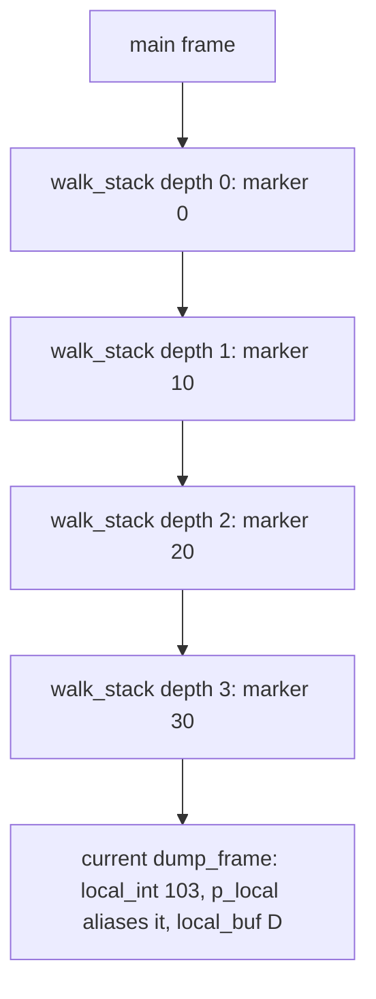
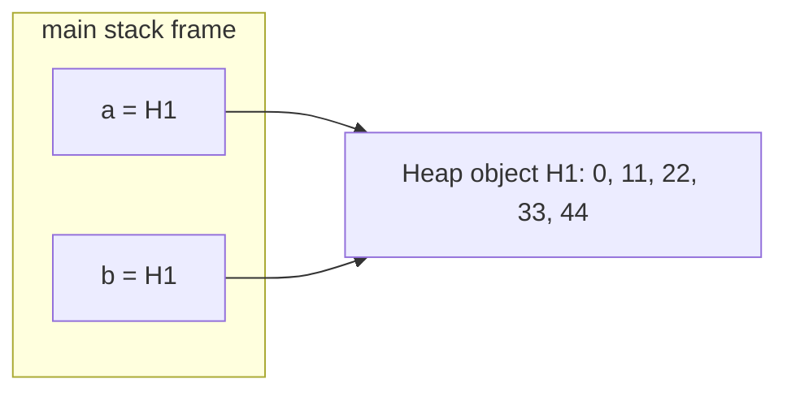
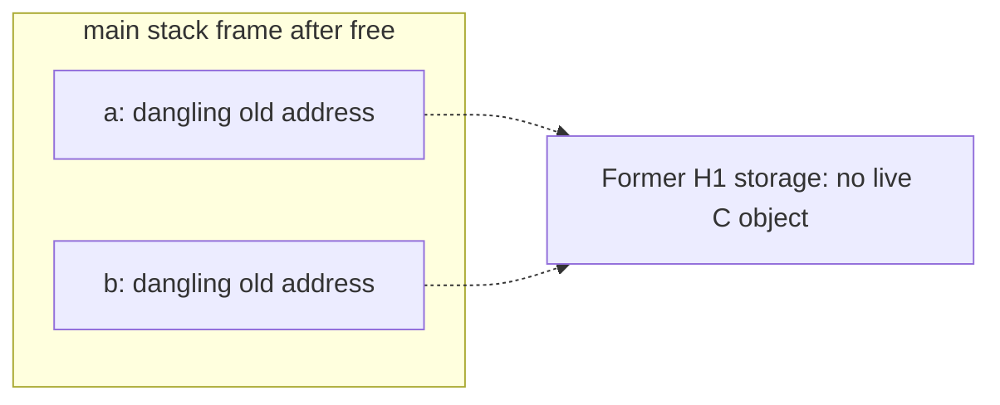

# Memory Maps

This analysis covers the two mandatory programs for the memory visualizer task:
`stack_example.c` and `aliasing_example.c`. Both programs were compiled and run
normally before their memory states were mapped.

## Build note

`stack_example` compiled with the supplied `Makefile`. On GCC 13.3.0, the full
`make` command stopped while compiling `aliasing_example.c` because GCC detected
the deliberate use-after-free and `-Werror` promoted the warning to an error.
The source code was not changed. To run the intended example, the same Makefile
target and required flags were used while demoting only that warning:

```bash
make stack_example
make aliasing_example CFLAGS='-Wall -Wextra -Werror -pedantic -std=gnu89 -g -Wno-error=use-after-free'
```

The addresses shown below came from one execution. They are evidence that the
pointers alias as described, but the exact addresses can change between runs.
The C language also does not guarantee that a stack grows toward lower
addresses, even though that is what happened on this system.

## `stack_example.c`

This program uses automatic local variables only. It does not allocate any
heap memory.

### Variables and lifetimes

| Function | Automatic objects | Lifetime |
| --- | --- | --- |
| `main` | Its own stack frame | From entry into `main` until it returns |
| `walk_stack` | Parameters `depth` and `max_depth`, plus `marker` | A separate set exists for each recursive call and remains alive until that call returns |
| `dump_frame` | Parameters `label` and `depth`, plus `local_int`, `local_buf`, and `p_local` | Created on each call and destroyed as soon as that particular call returns |

`p_local` stores the address of `local_int`, so the two expressions printed on
lines 13-14 have the same value:

```text
&local_int == p_local
```

This is a valid alias because both objects belong to the same active
`dump_frame` invocation. The pointer is never used after that invocation
returns.

### Step 1: first call

`main` calls `walk_stack(0, 3)`. Its first frame contains `marker = 0`.
`walk_stack` then calls `dump_frame("enter", 0)`, which creates temporary
locals with these values:

| Object | Value at depth 0 | Memory region |
| --- | --- | --- |
| `local_int` | `100` | Current `dump_frame` stack frame |
| `local_buf` | String `"A"` in a 16-byte array | Current `dump_frame` stack frame |
| `p_local` | Address of `local_int` | Current `dump_frame` stack frame |
| `marker` | `0` | Calling `walk_stack` frame |

When this first `dump_frame` call returns, its `local_int`, `local_buf`, and
`p_local` cease to exist. The depth-0 `walk_stack` frame and its `marker` remain
alive because that function has not returned.

### Step 2: recursive descent

Line 26 recursively calls `walk_stack` with increasing depths. Each call gets
its own `marker`; it does not overwrite the caller's `marker`. At the deepest
point, the active call stack is:



The earlier `dump_frame("enter", ...)` calls are not still active here. Each
one returned before the next recursive call began. Only the four `walk_stack`
frames and the currently executing `dump_frame` are active, in addition to
`main` and runtime frames.

The normal run produced the following addresses:

| Depth | `marker` address | `local_int` address | `p_local` | Values |
| ---: | --- | --- | --- | --- |
| 0 | `0x7ffe18911694` | `0x7ffe18911644` | `0x7ffe18911644` | `marker=0`, `local_int=100`, `local_buf="A"` |
| 1 | `0x7ffe18911664` | `0x7ffe18911614` | `0x7ffe18911614` | `marker=10`, `local_int=101`, `local_buf="B"` |
| 2 | `0x7ffe18911634` | `0x7ffe189115e4` | `0x7ffe189115e4` | `marker=20`, `local_int=102`, `local_buf="C"` |
| 3 | `0x7ffe18911604` | `0x7ffe189115b4` | `0x7ffe189115b4` | `marker=30`, `local_int=103`, `local_buf="D"` |

On this run, deeper recursive frames appeared at lower addresses. More
importantly, every depth had a distinct live `marker`, proving that each
recursive call had its own frame.

### Step 3: recursive return

At depth 3, `depth < max_depth` is false, so recursion stops. The program calls
`dump_frame("exit", 3)` and then the depth-3 `walk_stack` frame returns. The same
process repeats for depths 2, 1, and 0.

Each `marker` remains valid while the deeper call runs and still has its
original value when control returns. The exit calls to `dump_frame` use the
same addresses as the corresponding entry calls in this execution because the
finished stack storage was reused. They are still separate function calls with
separate variable lifetimes; an identical address does not make them the same
C object.

After `walk_stack(0, 3)` returns, all four recursive frames are gone. When
`main` returns, its frame also ends. No heap allocation exists and no memory
needs to be freed.

## `aliasing_example.c`

This program creates one heap allocation and then makes two stack-based pointer
variables refer to it.

### Step 1: before allocation

At the beginning of `main`, the memory state is:

| Stack object | Value |
| --- | --- |
| `a` | `NULL` |
| `b` | `NULL` |
| `n` | `5` |

There is no program-owned heap allocation yet.

### Step 2: allocation inside `make_numbers`

`make_numbers(5)` creates a new stack frame containing its parameter `n`, loop
counter `i`, and pointer `arr`. Line 12 allocates space for five integers on the
heap. On this system, `sizeof(int)` is 4 bytes, so the requested allocation is
20 bytes.

The loop initializes the allocation as:

```text
index:       0    1    2    3    4
value:       0   11   22   33   44
```

While `make_numbers` is active, `arr` points to this allocation. Returning
`arr` copies the address into `a`; it does not copy the five integers. The
`make_numbers` stack frame then ends, but the heap object remains alive because
heap lifetime is controlled by `free()`, not by the lifetime of the function
that called `malloc()`.

### Step 3: alias creation

Line 34 performs `b = a`. It copies the address, not the allocation. Immediately
afterward the memory map is:



`a` and `b` are two distinct pointer variables, but they contain the same
address and alias the same heap object. The observed output confirmed this:

```text
a=0x55fde4de02b0 b=0x55fde4de02b0 a[2]=22 b[2]=22
```

For ownership reasoning, `a` can be treated as the owning pointer and `b` as a
non-owning alias. Ownership is a programming convention rather than a separate
C memory property, but it makes the responsibility to call `free()` exactly
once explicit.

### Step 4: allocation freed through `a`

Line 38 calls `free(a)`. This ends the lifetime of heap object H1 immediately.
`free()` does not set either pointer variable to `NULL`, and freeing through
`a` does not preserve the object for `b`.



The variables `a` and `b` remain in the `main` stack frame, but neither points
to a live object. The diagram's "old address" describes the bit pattern seen in
this run; under the C object-lifetime rules, the dangling pointer value is
indeterminate and must not even be relied upon for printing or comparison. The
allocator may reuse or alter the released storage at any time. Calling
`free(b)` now would not fix the alias; it would attempt to free the same
allocation a second time.

### Step 5: invalid accesses

The remaining operations all rely on the ended lifetime of H1:

| Source line | Operation | Memory error |
| ---: | --- | --- |
| 40 | Attempts to print the old pointer representation stored in `b` | Evaluates an indeterminate dangling pointer; undefined behavior |
| 42 | Reads `b[2]` | Use-after-free and invalid read |
| 44 | Writes `1234` to `b[3]` | Use-after-free and invalid write; it may corrupt allocator or unrelated data |
| 45 | Reads `b[3]` for `printf` | Another invalid read after the invalid write |

The normal execution happened to continue and printed:

```text
after free(a): b=0x55fde4de02b0 (dangling)
reading b[2]=1652424105
wrote b[3]=1234
```

The value `1652424105` is not a valid result from the original array. More
importantly, even an output of `22` would not make the read valid. Use-after-free
is undefined behavior: the program could print an old value, print a different
value, corrupt memory, or crash. A successful-looking run is not evidence of
correctness.

The allocation itself was freed once, so the normal successful-allocation path
does not leak it. The bug is invalid access after the allocation's lifetime,
not missing deallocation.

## Critical review of the AI-generated maps

### Incorrect claim 1: all `dump_frame` calls remain active

An initial AI-generated explanation placed one `dump_frame` stack frame at
every recursion depth and claimed they all remained alive until the recursion
unwound.

That map was incorrect. Line 22 calls `dump_frame`, but that call returns before
line 26 starts the next `walk_stack` call. Therefore the recursive chain
contains multiple active `walk_stack` frames, but only one active `dump_frame`
at a time. The repeated entry and exit addresses show stack-slot reuse, not one
long-lived set of `dump_frame` locals.

### Incorrect claim 2: `free(a)` invalidates only `a`

Another misleading AI explanation stated that `free(a)` invalidates `a`, while
`b` remains usable because it is a different pointer variable.

That confuses pointer variables with the allocated object. `a` and `b` are
different stack objects, but they alias one heap object. `free(a)` ends that
heap object's lifetime, so every pointer that referred to it becomes dangling.
The fact that `b` still prints the old address does not restore the allocation
or permit `b[2]` and `b[3]` to be accessed.

## Final comparison

| Program | Stack behavior | Heap behavior | Invalid operation |
| --- | --- | --- | --- |
| `stack_example` | Recursive `walk_stack` frames coexist; temporary `dump_frame` frames are created and destroyed one at a time | No heap allocation | None |
| `aliasing_example` | `a` and `b` are separate local variables containing the same address | One integer array is allocated, then freed once | Read and write through a dangling alias after `free(a)` |

The key distinction is that stack objects normally end when their function
invocation returns, while a successful heap allocation remains alive until it
is explicitly freed. Pointer assignment never creates a second heap object; it
only creates another way to refer to the same one.

## References

- [Valgrind User Manual: Memcheck](https://valgrind.org/docs/manual/mc-manual.html)
- [SEI CERT C, MEM30-C: Do not access freed memory](https://cmu-sei.github.io/secure-coding-standards/sei-cert-c-coding-standard/rules/memory-management-mem/mem30-c/)
- [GCC warning options](https://gcc.gnu.org/onlinedocs/gcc/Warning-Options.html)
