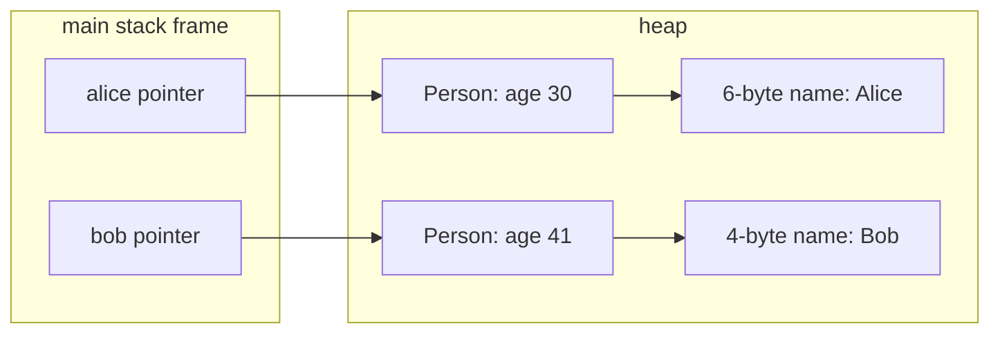
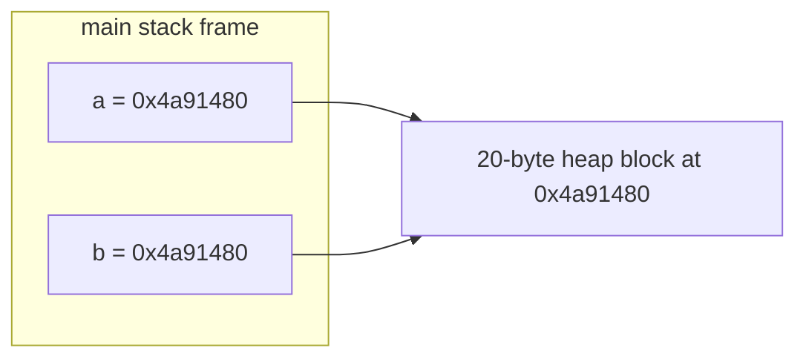

# Valgrind Analysis

This report analyses the two mandatory memory-tracer programs,
`heap_example.c` and `aliasing_example.c`. The results were produced with
Valgrind 3.26.0 using:

```bash
valgrind --leak-check=full --show-leak-kinds=all \
    --track-origins=yes ./heap_example

valgrind --leak-check=full --show-leak-kinds=all \
    --track-origins=yes ./aliasing_example
```

`--leak-check=full` provides an allocation stack trace for each leak,
`--show-leak-kinds=all` displays every leak category, and
`--track-origins=yes` requests origin information if undefined values are
used.

## Results summary

| Program | Valgrind result | Classification |
| --- | --- | --- |
| `heap_example` | 6 bytes in 1 block definitely lost | Memory leak caused by lost ownership |
| `aliasing_example` line 42 | Invalid read of size 4 | Use-after-free read through `b` |
| `aliasing_example` line 44 | Invalid write of size 4 | Use-after-free write through `b` |
| `aliasing_example` line 45 | Invalid read of size 4 | Use-after-free read through `b` |

Neither run reported the use of uninitialized memory. `heap_example` reported
one error context, while `aliasing_example` reported three separate error
contexts.

## `heap_example.c`

### Allocation structure

Each call to `person_new` creates two independent heap objects:

1. A `Person` structure allocated on line 14.
2. A separate character array for `p->name` allocated on line 21.

After both calls return, the live objects can be represented as:



The string `"Alice"` needs six bytes: five visible characters and the null
terminator. The string `"Bob"` needs four bytes.

### Correct cleanup of `bob`

Lines 66-67 free both parts of `bob` in the correct order:

```c
free(bob->name);
free(bob);
```

The nested name allocation is freed while it is still reachable through the
live structure. The outer structure is then freed. Neither `bob` allocation is
present in the leak report.

### Incomplete cleanup of `alice`

Line 69 calls `person_free_partial(alice)`. That function only executes:

```c
free(p);
```

This releases the outer `Person` structure but not the separate allocation
referenced by `p->name`. Once the structure is freed, the program has lost its
only pointer to the six-byte `"Alice\0"` allocation. It can no longer pass that
address to `free()`.

Valgrind reports exactly this lost allocation:

```text
6 bytes in 1 blocks are definitely lost in loss record 1 of 1
   at 0x4850858: malloc (vg_replace_malloc.c:447)
   by 0x4001211: person_new (heap_example.c:21)
   by 0x40012FA: main (heap_example.c:51)
```

The stack trace maps the leak back to the name allocation on line 21 during
the call that creates `alice` on line 51. The outer structure allocation does
not appear because line 69 successfully frees it.

### Leak classification

The block is **definitely lost**, not indirectly lost or still reachable.
Valgrind cannot find any live pointer to the start of the six-byte block when
the program exits. The only pointer was stored inside the `Person` structure
that has already been freed.

The final summary confirms that this is the only remaining block:

```text
HEAP SUMMARY:
    in use at exit: 6 bytes in 1 blocks
  total heap usage: 5 allocs, 4 frees, 1,066 bytes allocated

LEAK SUMMARY:
   definitely lost: 6 bytes in 1 blocks
   indirectly lost: 0 bytes in 0 blocks
     possibly lost: 0 bytes in 0 blocks
   still reachable: 0 bytes in 0 blocks
        suppressed: 0 bytes in 0 blocks

ERROR SUMMARY: 1 errors from 1 contexts
```

The run did not report an invalid read, invalid write, or uninitialized value.
The defect is specifically a missing deallocation caused by losing ownership
of `alice->name`.

## `aliasing_example.c`

### Allocation and aliasing

Line 12 allocates five integers. Each integer occupies four bytes in this run,
so the heap block is 20 bytes. The allocation begins at `0x4a91480` and is
initialized to:

| Index | 0 | 1 | 2 | 3 | 4 |
| ---: | ---: | ---: | ---: | ---: | ---: |
| Value | 0 | 11 | 22 | 33 | 44 |
| Byte offset | 0 | 4 | 8 | 12 | 16 |

Line 34 executes `b = a`. This copies the address, so both stack variables
refer to the same 20-byte heap object:



Line 38 calls `free(a)`. Deallocation ends the lifetime of the one shared heap
object. It does not matter that the operation used `a`; `b` aliases the same
object and becomes dangling at the same time.

### Error 1: invalid read at line 42

Line 42 evaluates `b[2]`. Array indexing calculates an address eight bytes from
the start of the block:

```text
0x4a91480 + (2 * 4 bytes) = 0x4a91488
```

Valgrind reports the same address and offset:

```text
Invalid read of size 4
   at 0x40012F2: main (aliasing_example.c:42)
 Address 0x4a91488 is 8 bytes inside a block of size 20 free'd
   at 0x48538BF: free (vg_replace_malloc.c:990)
   by 0x40012CE: main (aliasing_example.c:38)
 Block was alloc'd at
   at 0x4850858: malloc (vg_replace_malloc.c:447)
   by 0x40011E4: make_numbers (aliasing_example.c:12)
   by 0x4001272: main (aliasing_example.c:30)
```

This is a four-byte use-after-free read. The output happened to remain `22`,
but that value only shows that the released bytes had not yet been overwritten
in this Valgrind run. It does not make the access valid.

### Error 2: invalid write at line 44

Line 44 assigns `1234` to `b[3]`. Element 3 begins 12 bytes into the released
block:

```text
0x4a91480 + (3 * 4 bytes) = 0x4a9148c
```

Valgrind reports:

```text
Invalid write of size 4
   at 0x4001312: main (aliasing_example.c:44)
 Address 0x4a9148c is 12 bytes inside a block of size 20 free'd
```

The allocation and deallocation stack traces again identify line 12 as the
allocation and line 38 as the `free()`. This is a four-byte use-after-free
write. Writing successfully does not recreate the object. It modifies storage
that is controlled by the allocator and could already have been reused.

### Error 3: invalid read at line 45

Line 45 reads `b[3]` so that `printf` can display the value written on line 44.
It accesses the same invalid address, `0x4a9148c`:

```text
Invalid read of size 4
   at 0x4001320: main (aliasing_example.c:45)
 Address 0x4a9148c is 12 bytes inside a block of size 20 free'd
```

This is a separate use-after-free read, so Valgrind records it as a third error
context. Printing `1234` does not prove that either line 44 or line 45 was safe;
both accesses have undefined behavior.

### Heap and initialization result

The allocation is freed exactly once on line 38, so this program has no memory
leak even though it performs invalid accesses afterward:

```text
HEAP SUMMARY:
    in use at exit: 0 bytes in 0 blocks
  total heap usage: 2 allocs, 2 frees, 1,044 bytes allocated

All heap blocks were freed -- no leaks are possible
ERROR SUMMARY: 3 errors from 3 contexts
```

There are also no uninitialized-value warnings. `make_numbers` initializes all
five elements before returning. Valgrind classifies the later accesses as
invalid because the block has been freed, not because its original integers
were uninitialized.

## Verification against the source and memory maps

The `aliasing_example` trace agrees with `memory_maps.md`: `a` and `b` contain
the same base address before line 38, and both become dangling when that one
allocation is freed. The reported offsets also match the mapped array exactly:
index 2 is eight bytes from the base and index 3 is 12 bytes from the base.

The `heap_example` interpretation was checked directly against the two
allocations in `person_new`. A `Person` and its `name` are separate heap
objects, so freeing the structure cannot automatically free the character
array. Valgrind's allocation stack identifies the name allocation on line 21,
which rules out the outer structure on line 14 as the leaked object.

## Critical review of the AI interpretation

### Incorrect AI explanation: the entire `alice` object leaked

An initial AI explanation described `heap_example` as leaking the `Person`
structure and its name, with the name classified as indirectly lost.

That interpretation is contradicted by both the code and Valgrind. Line 69
frees the outer `Person` structure. Only the six-byte name allocation remains,
and Valgrind classifies that block as **definitely lost**. An indirectly lost
block would normally still be reachable from another lost heap block. Here,
the structure containing the pointer is not lost; it was explicitly freed.

### Incomplete AI explanation: printing `22` means the read worked

A second AI interpretation treated `reading b[2]=22` as evidence that the
freed allocation was still usable. This confuses retained byte contents with
object lifetime. Valgrind marked the entire block unaddressable when line 38
freed it and reported the read at line 42 even though the old bytes still
represented `22`.

Valgrind did not warn when line 40 merely printed the numeric pointer value.
This does not prove that all C operations on a dangling pointer are valid.
Memcheck reports the later operations when the program actually reads from or
writes to the deallocated heap block. Dynamic tools detect particular runtime
events and should not be treated as proof that every unreported operation is
defined by the C language.

## Final conclusions

- `heap_example` violates ownership rules by freeing the outer `alice`
  structure before freeing its separately allocated name. This loses the only
  usable reference to six bytes and produces one definite leak.
- `aliasing_example` releases its allocation, so it has no leak, but both
  aliases become dangling. It then performs one invalid write and two invalid
  reads through `b`.
- A program can finish normally and print expected values while still having
  undefined memory behavior.
- A clean leak summary does not imply a memory-safe program, and an invalid
  access does not necessarily imply a leak.

## References

- [Valgrind User Manual: Memcheck](https://valgrind.org/docs/manual/mc-manual.html)
- [SEI CERT C, MEM30-C: Do not access freed memory](https://cmu-sei.github.io/secure-coding-standards/sei-cert-c-coding-standard/rules/memory-management-mem/mem30-c/)
